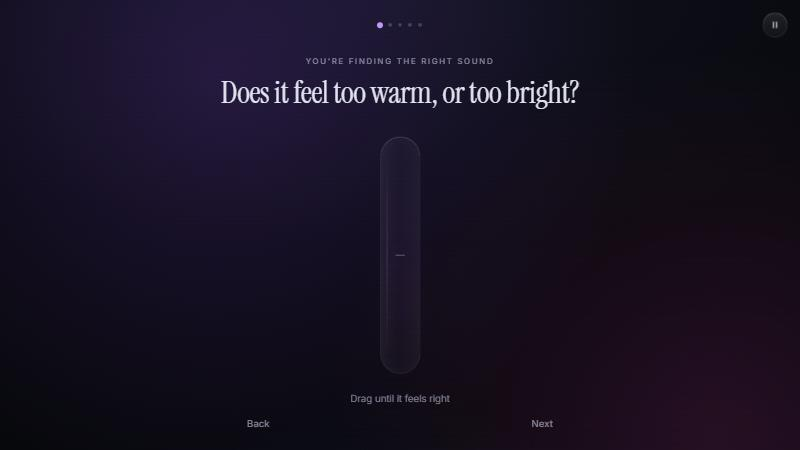
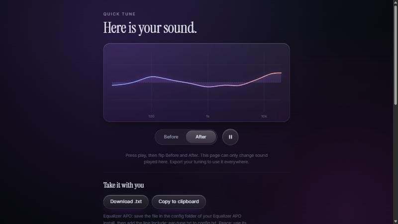

# Tuneable

**Live demo: [wesley-lo.github.io/Tuneable](https://wesley-lo.github.io/Tuneable/)**

Tune your headphones by ear. Play some music, drag one big glass slider through five short steps, and get an EQ preset you can export.

Everything runs in the browser. There is no backend, no account, and nothing is uploaded. Music you pick is played from your own device.

| A tuning step | The result |
|---|---|
|  |  |

## Run it

You need Node.js 20 or newer.

```bash
npm install
npm run dev
```

Build a static site into `dist/`:

```bash
npm run build
npm run preview
```

The build uses a relative base path, so `dist/` works on Vercel, Netlify, or a GitHub Pages project site without changes. Routing uses only the URL hash.

### Music

The setup screen offers three built-in tracks by Kevin MacLeod ([incompetech.com](https://incompetech.com)), all licensed under [Creative Commons: By Attribution 4.0](https://creativecommons.org/licenses/by/4.0/):

- "Funkorama": a grooving bass line and drums, with guitar and organ
- "Modern Jazz Samba": upright bass, guitar and piano, with a bright flute and rhythm
- "Cool Rock": a heavy kit and bass with an electric guitar

Visitors can also play a file from their own device, which never leaves it. If the built-in files are missing, the app plays a short demo track that it generates in the browser.

To add built-in songs, copy the files into `public/audio/`, then list them in `src/audio/library.ts` with their licence details. The footer shows a short attribution, and a separate Music credits page (linked from the footer) lists each track with its source and licence, both generated from that list. Only add music you have the right to publish: CC0, public domain, CC BY (with credit), your own work, or tracks you have written permission to use. Avoid NonCommercial (NC) and NoDerivatives (ND) licences, because this app applies EQ to the audio and may be monetised later. See `public/audio/README.txt`.

## How it works

### Audio

All sound goes through the Web Audio API:

```
MediaElementSource -> wet -> EQ filters -> preamp --+
                   \-> dry --------------------------+-> limiter -> master -> destination
```

- The EQ is a chain of `BiquadFilterNode`s (low shelf, high shelf, and peaking filters) built from a config object.
- **Preamp compensation.** The preamp drops by the highest point of the combined curve, so boosting never clips, and a louder result never sounds better by accident.
- **Bypass.** The Before / After toggle crossfades to a dry path over about 60 ms, so there are no pops. The dry path is level matched to the preamp, so the comparison is about tone, not loudness.
- **Click-free sliders.** Every gain change uses `setTargetAtTime` with a 30 ms time constant.
- **Safety.** Each step is capped at plus or minus 8 dB (one constant, `GAIN_LIMIT`). A `DynamicsCompressorNode` acts as a limiter, and playback always fades in over about a second.
- The curve on the result screen comes from `BiquadFilterNode.getFrequencyResponse()`, not a drawing of what the curve should look like.

### Modes are config

`src/audio/modes.ts` describes a mode: a list of filters, and a list of steps that say which filters each step moves, and by how much. Quick Tune is one entry. Rush Tune (10 band) and Deep Tune (30 band) would be more entries, with no engine changes.

The General step is a tilt: it moves a low shelf and a high shelf in opposite directions.

### The slider

The slider is hand written, with no UI library.

- The whole screen is the drag target (Pointer Events with pointer capture, so mouse, touch, and pen all work), and drag is relative. Nobody has to aim at a handle.
- A soft detent sits around 0 dB, and a small pulse (and a light vibration where supported) marks the crossing.
- There is no number on screen. A long press shows the dB value.
- Keyboard: arrow keys move in 0.5 dB steps, Page Up and Page Down in 2 dB steps, Home and End jump to the ends, and 0 resets. The slider has `role="slider"` with `aria-valuenow`, `aria-valuemin`, `aria-valuemax`, and a spoken value.
- `prefers-reduced-motion` removes the drifting background, the slide transitions, and the easing.

### Export and sharing

- **Equalizer APO / Peace.** A text file with a `Preamp` line and one `Filter` line per active band.
- **Readable list.** Every band and gain in plain numbers, for any other EQ app. Phone apps such as Wavelet and Poweramp need these values typed in for now.
- **Share link.** The settings live in the URL hash, like `#b=3.0,-1.5,2.0,0.0,-2.0&m=quick`. Opening the link loads the preset into the result screen.
- **QR code.** A small QR encoder in `src/export/qr.ts` (about 300 lines, byte mode, versions 1 to 10). The code is generated in the browser and was checked by decoding it with an independent QR reader.

The page can only process sound played inside the page. It cannot change your system-wide sound. That is what the export is for.

## Project layout

```
src/
  main.ts              app entry, routing, transitions
  app.ts               shared types for screens
  audio/
    engine.ts          Web Audio chain, bypass, preamp
    modes.ts           mode configs (Quick Tune now)
    library.ts         library of preset music
    response.ts        real biquad response, preamp maths
    demo.ts            procedural demo track
    tracks.ts          built-in or local file
  ui/
    slider.ts          the glass slider
    curve.ts           the EQ curve graph
    ambient.ts         background glow that follows the slider
    screens/           welcome, setup, step, result
  export/
    apo.ts             Equalizer APO text and the readable list
    share.ts           URL hash encode and decode
    qr.ts              QR code generator
  styles/              tokens, base, glass, screens, slider, animations
public/audio/          built-in songs (listed in src/audio/library.ts)
```

## Design notes

- Dark and calm, with plenty of empty space. The slider is a thin pill of frosted glass that fades in when touched, and a droplet follows your finger.
- The background glow shifts hue and brightness with the slider, so the screen itself tells you which way you are going.
- Type: Instrument Serif for questions, Inter for everything else. Both are self-hosted, so there are no third-party requests.
- The copy is short and has no jargon on the main screens.

## Later

Rush Tune and Deep Tune on the same engine, per-band A/B tests, measured starting points for a chosen headphone model, target curves, and saved profiles. None of that is built, and nothing in v1 blocks it.
